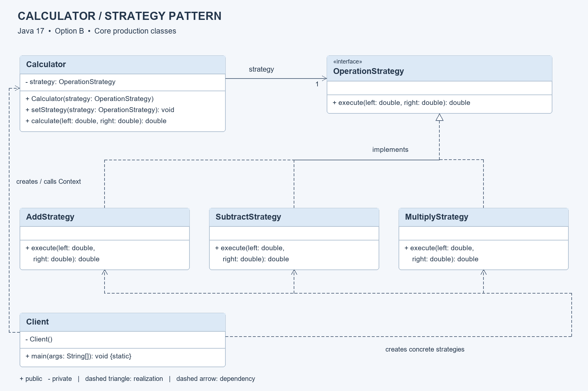

# Assignment 5: Strategy Pattern — Calculator

Repository: https://github.com/Asylstyle/sdp-assignment5-strategy

## 1. Introduction: domain and algorithm family

Option B uses a calculator with interchangeable arithmetic algorithms.
Addition, subtraction and multiplication all accept two double operands and return
one double. Their common contract is OperationStrategy.execute(left, right).

Strategy encapsulates each algorithm in a separate class. Calculator stores one
OperationStrategy reference. Client selects the concrete implementation and can
replace it at runtime. This avoids adding operation-type branches to the context.
The example deliberately uses explicit classes so each pattern role is visible.

## 2. UML and responsibilities



Editable source: [PlantUML](docs/strategy-uml.puml); [SVG](docs/strategy-uml.svg).
The checked-in SVG/PNG layout is generated by docs/render_uml.py (Python + Pillow);
the PlantUML source captures the same model for editing in UML tools.
Visibility: + public, - private. Dashed hollow-triangle arrows mean interface
realization; dashed open arrows mean dependency; the solid navigable association
means Calculator holds exactly one strategy. The main diagram covers production
core classes; the independent extension implements the same interface.

| Role | Class | Responsibility |
| --- | --- | --- |
| Strategy | OperationStrategy | Defines execute(double, double) |
| Context | Calculator | Holds, replaces and delegates to a strategy |
| Concrete strategies | AddStrategy, SubtractStrategy, MultiplyStrategy | Implement one algorithm each |
| Client | Client | Constructs context, selects strategies, prints results |

Call flow: Client creates Calculator(AddStrategy) → calculate(12,4) delegates to
execute → 16.0. Client calls setStrategy(SubtractStrategy) → the **same** context
returns 8.0. Multiplication then returns 48.0. No algorithm is chosen by Calculator.

## 3. Clean Code principles with evidence

The “before” excerpts below are illustrative alternatives, not invented project
history. Each “after” excerpt comes from this implementation.

### 3.1 Meaningful names

Before: `double f(double a, double b)`.

After, OperationStrategy.java:
```java
double execute(double left, double right);
```

The type names AddStrategy and Calculator describe their roles. left and right
preserve operand order, which matters for subtraction.

### 3.2 Single Responsibility Principle

Before: a Calculator calculates, reads keyboard input and prints results.

After, Calculator.java:
```java
public double calculate(double left, double right) {
    return strategy.execute(left, right);
}
```

Calculator manages delegation. Client.main handles demonstration and output.
Each strategy owns one arithmetic rule. UI changes do not require arithmetic edits.

### 3.3 Small, focused methods

Before: one long method selects an operation, validates input and computes results.

After, MultiplyStrategy.java:
```java
public double execute(double left, double right) {
    return left * right;
}
```

One visible expression makes the operation easy to inspect and explain. There is
no unnecessary helper hierarchy for a one-line algorithm.

### 3.4 Open/Closed Principle and polymorphism

Before:
```java
if (operation.equals("add")) return left + right;
// Every new operation needs another context branch.
```

After, Calculator.java:
```java
return strategy.execute(left, right);
```

DivideStrategy implements OperationStrategy in examples/extension. ExtensionClient
selects it. Existing core files remain unchanged. Client selection is allowed to
depend on concrete classes; the context depends only on the interface.

### 3.5 Encapsulation and valid objects

Before: `public OperationStrategy strategy;` allows arbitrary external replacement,
including null, and produces a later unexplained failure.

After, Calculator.java:
```java
private OperationStrategy strategy;
public void setStrategy(OperationStrategy strategy) {
    this.strategy = Objects.requireNonNull(strategy, "Strategy must not be null");
}
```

The constructor uses this setter too. A null update throws before assignment, so
the previous valid strategy remains usable. There is always one strategy after a
successful construction.

### 3.6 Depend on abstractions

Before: `private AddStrategy strategy;` limits Calculator to addition.

After:
```java
private OperationStrategy strategy;
```

The dependency is the common contract. Concrete classes are replaceable, including
a test lambda. This supports testing and extension without coupling the context to
a specific arithmetic implementation.

## 4. Strategy versus State

| Aspect | Strategy | State |
| --- | --- | --- |
| Intent | Choose an interchangeable algorithm | Change behavior as internal state changes |
| Selection | Usually chosen by the client | Often transitions within context or state objects |
| Relationship | Algorithms are independent alternatives | States often know transitions to other states |
| Example | Select multiplication instead of addition | Order moves from New to Paid to Shipped |

Both commonly use composition, a shared interface and delegation. Intent is the
key difference, not the class diagram alone. This calculator uses Strategy because
Client explicitly selects an arithmetic algorithm; operations do not transition
to one another as a lifecycle progresses. setStrategy changes the algorithm reference,
not an order-like domain state.

## 5. Conclusion and technical reflection

Strategy gives this calculator runtime flexibility and a stable context. The
division extension demonstrates the benefit directly: only new files are needed.
The cost is additional classes, files and client-side wiring. For a tiny fixed
calculator, direct functions could be shorter; explicit strategies are useful when
algorithms need independent growth, testing or configuration.

The design keeps numeric behavior deliberately narrow: double has rounding and
overflow, and the extension rejects zero division. It is not a precision-money
model. A console menu could be added to Client without putting selection branches
inside Calculator. This is a technical evaluation of the design, not a claim about
a student's personal learning experience.

## 6. Build, validation and repository evidence

Build/run commands and extension instructions: [README](README.md).
Tests: 19 core checks and 6 extension checks cover all required operations,
repeated runtime switching, zero/negative/fractional values, null rejection,
unchanged strategy after a rejected update, a new implementation, NaN/infinity,
and division by positive/negative zero.

The test programs throw AssertionError on failure and return a nonzero process
exit code. They do not rely on Java assertions being enabled.

Public source and real incremental commits:
https://github.com/Asylstyle/sdp-assignment5-strategy

| Assignment requirement | Evidence |
| --- | --- |
| Java 17, complete compiling code | README commands use --release 17 |
| Interface with execution method | OperationStrategy.execute |
| At least three strategies | AddStrategy, SubtractStrategy, MultiplyStrategy |
| Context reference and delegation | Calculator.strategy and calculate |
| Runtime switching | Client.main reuses one Calculator |
| No strategy-type conditionals in context | Calculator has no if/switch/instanceof |
| Client chooses algorithms | new strategy calls in Client |
| New strategy without existing edits | examples/extension |
| Five justified Clean Code principles | Section 3 includes six concrete excerpts |
| UML, Strategy vs State, tradeoffs | Sections 2, 4, 5 |
| Defense preparation | DEFENSE_RU.md |
| Public GitHub and incremental history | Repository link and Git log |

## AI assistance and submission policy

Code, diagram, tests and documentation were prepared with AI assistance as a worked
reference. The assignment permits AI only for reference examples and clarification.
This disclosure does not override course policy or establish that submission is
permitted. The student must understand the implementation, follow the instructor's
rules and make the submission decision. No personal experience or independent
authorship is asserted. No Moodle submission or guaranteed grade is claimed.

The PDF lists 26.10.2026 23:59 but also contains an inconsistent weekday reference;
the authoritative deadline should be checked in Moodle.
